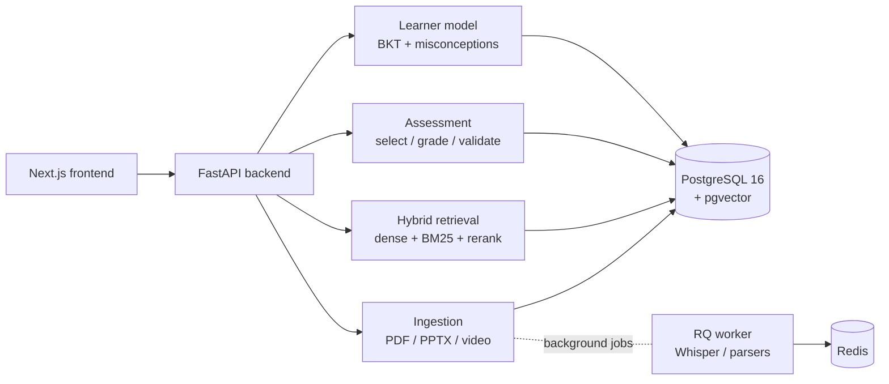

# KnowTrace

**KnowTrace is a source-anchored adaptive AI tutor.** You give it course
material — PDF textbooks, lecture slides, recorded video lectures — and it
becomes a study companion that:

- **Answers only from your material.** Every answer carries citations back to
  the exact page, slide, or video timestamp it came from. Questions the
  material doesn't cover are refused ("Not found in your course material"),
  and any outside knowledge is explicitly labeled `[OUTSIDE KNOWLEDGE]`.
- **Diagnoses what you don't know.** It builds a knowledge graph of concepts
  and prerequisites from your sources, tracks your mastery with Bayesian
  Knowledge Tracing, and detects recurring misconceptions from your wrong
  answers.
- **Adapts practice to you.** Quizzes, diagnostic tests, mock exams, and
  study plans are selected based on your current mastery, weak prerequisites,
  and forgetting curve — not a fixed syllabus order.
- **Finds courses for you.** Built-in connectors search public catalogs
  (NPTEL, SWAYAM, MIT OCW, MITx, Khan Academy, edX, Coursera) and promote a
  discovered course into a full tutoring workspace with one click.

It is a full-stack application: a **FastAPI** backend with **PostgreSQL +
pgvector**, **Redis/RQ** background workers, and a **Next.js** web frontend.

> **Honesty note.** The learning-effectiveness numbers reported below come
> from an offline simulator that uses an independent IRT model, and from
> fixture/eval-target data — they are not evidence of efficacy with real
> human learners. The simulator and all simulated outputs are explicitly
> labeled as such throughout the codebase.

---

## Table of contents

- [How it works](#how-it-works)
- [Tech stack](#tech-stack)
- [Quick start (Docker)](#quick-start-docker)
- [Local development (without Docker)](#local-development-without-docker)
- [Using the app](#using-the-app)
- [API overview](#api-overview)
- [Project structure](#project-structure)
- [Evaluation](#evaluation)
- [Testing & CI](#testing--ci)
- [Documentation](#documentation)

---

## How it works

### Pipeline



### 1. Ingestion with a provenance spine

Sources (PDF, PPTX, video) are parsed into content chunks. **Every chunk
stores its exact origin**: `source_id` plus page number, slide number, or
video `ts_start`/`ts_end` (and a bounding box for figures/tables). Each chunk
also gets a 1024-dim embedding (BAAI/bge-m3). Video is processed with
scene detection (PySceneDetect) and speech recognition (faster-whisper).

Long-running parsing runs in the background on an **RQ worker** (queues:
`default`, `ingestion`, `assessments`), so uploads return immediately with a
trackable processing status.

### 2. Grounded tutoring

A question goes through: hybrid retrieval (dense vectors + BM25 lexical
search) → reranking (bge-reranker-v2-m3) → a sufficiency check → grounded
generation → sentence-by-sentence claim verification. The model receives
chunk identifiers and can never invent page numbers; the API resolves the
`[S#]` citation labels back to real provenance. Insufficient evidence
triggers a refusal instead of a hallucinated answer.

### 3. Assessment pipeline

Questions are generated from course chunks, then validated by a **second,
independent LLM vendor** (psychometric + factual audit). Only questions that
pass and are marked `status="approved"` are ever served to a learner.
Assessments come in three flavors — diagnostic, quiz, mock exam — and each
response is graded, checked for misconceptions, and fed back into the
learner model.

### 4. Learner model & adaptation

- **Bayesian Knowledge Tracing** maintains per-concept mastery
  (`P(correct) = p·(1−slip) + (1−p)·guess`), with a transparent forgetting
  model (exponential decay, adaptive half-life).
- **Misconception detection** classifies wrong-answer patterns and links
  each misconception to remediation chunks from the student's own material.
- **Prerequisite propagation** gives extra practice to weak prerequisites
  before advancing.
- **Study plans** are generated and re-planned as mastery changes.

All prompts live centrally in `services/<module>/prompts.py` (no inline
prompts), and all LLM calls go through a single resilient gateway
(`backend/core/llm.py`) with retries, JSON-schema validation, and caching.

### 5. Dual-vendor LLM design

| Role | Vendor | Used for |
| --- | --- | --- |
| Generation & vision | Google Gemini | tutoring answers, ingestion understanding, long context |
| Validation & verification | Groq (llama3-70b) / Claude | question auditing, grading, claim verification, RAGAS judging |

Using a separate vendor to *check* the generator's output is a core
correctness mechanism, not redundancy.

---

## Tech stack

| Layer | Technology |
| --- | --- |
| Frontend | Next.js (App Router), React 19, TypeScript, Tailwind CSS 4, TanStack React Query, @xyflow/react (knowledge graph), Recharts |
| Backend | Python 3.11, FastAPI, SQLAlchemy 2, Pydantic 2 |
| Database | PostgreSQL 16 + pgvector (1024-dim vectors), Alembic migrations |
| Queue | Redis 7 + RQ (background ingestion & assessment jobs) |
| LLMs | Google Gemini (generation/vision), Groq + Anthropic Claude (validation) |
| Embeddings / rerank | BAAI/bge-m3, BAAI/bge-reranker-v2-m3 |
| Ingestion | PyMuPDF (PDF), python-pptx (PPTX), faster-whisper + PySceneDetect (video) |
| Quality | pytest, Ruff, mypy, GitHub Actions CI |

---

## Quick start (Docker)

Prerequisites: Docker + Docker Compose, and API keys for Gemini and Groq
(the two LLM vendors).

```bash
# 1. Configure environment
cp .env.example .env
#    → set GEMINI_API_KEY and GROQ_API_KEY (minimum required)

# 2. Start everything: Postgres+pgvector, Redis, API, worker, frontend
docker compose up -d
```

Then open:

- **Frontend:** <http://localhost:3000>
- **API docs (Swagger):** <http://localhost:8000/docs>
- **API health:** <http://localhost:8000/api/v1/health>

Services started by Compose:

| Service | Container | Port | Purpose |
| --- | --- | --- | --- |
| `postgres` | knowtrace-postgres | 5432 | PostgreSQL 16 + pgvector, schema auto-loaded from `database/schema.sql` |
| `redis` | knowtrace-redis | 6379 | Job queue backend |
| `api` | knowtrace-api | 8000 | FastAPI application |
| `worker` | knowtrace-worker | — | RQ worker (`default ingestion assessments` queues) |
| `frontend` | knowtrace-frontend | 3000 | Next.js web app |

**Offline demo fixtures** (no API keys or provider calls needed):

```bash
python scripts/prepare_demo.py   # writes fixtures to data/demo_data/
```

This generates a deterministic simulator snapshot and demo student
identities (`fresh_user@demo.local`, `returning_user@demo.local`) under
`data/demo_data/` — useful for a canned demo or CI without live LLM usage.

---

## Local development (without Docker)

You can run the API and frontend directly for a faster edit loop. You still
need a reachable PostgreSQL (with pgvector) and Redis — easiest via
`docker compose up -d postgres redis`.

```bash
# One-time setup
python -m venv .venv && source .venv/bin/activate   # Windows: .venv\Scripts\activate
pip install -r requirements.txt
cp .env.example .env                                # then edit values

# Database schema — Compose loads database/schema.sql automatically on first boot.
# For an external Postgres, apply the dump, then run incremental migrations:
#   psql "$DATABASE_URL" -f database/schema.sql
alembic upgrade head

# Terminal 1 — API (http://localhost:8000)
uvicorn backend.main:app --host 0.0.0.0 --port 8000 --reload

# Terminal 2 — background worker
rq worker default ingestion assessments

# Terminal 3 — frontend (http://localhost:3000)
cd frontend && npm install && npm run dev
```

Handy scripts:

```bash
python scripts/seed_db.py        # seed demo data
./scripts/run_dev.sh backend     # or: worker | seed | docker
```

Key environment variables (see `.env.example` for the full list):

| Variable | Purpose |
| --- | --- |
| `GEMINI_API_KEY`, `GEMINI_MODEL` | Vendor A — generation & vision |
| `GROQ_API_KEY`, `GROQ_MODEL`, `ANTHROPIC_API_KEY` | Vendor B — validation & judging |
| `DATABASE_URL` | PostgreSQL connection string |
| `REDIS_URL` | Redis connection string |
| `EMBEDDING_MODEL`, `VECTOR_DIMENSION` | Embedding config (default `BAAI/bge-m3`, 1024) |
| `BACKEND_CORS_ORIGINS` | Allowed frontend origins |

---

## Using the app

A typical flow in the web UI:

1. **Discover** (`/discover`) — search public course catalogs across
   platforms, or go to `/courses/new` to upload your own PDF/PPTX/video
   sources to a new course.
2. **Tutor** (`/courses/[id]/tutor`) — ask questions; answers arrive with
   clickable citations into the source (page/slide/timestamp) viewer.
3. **Map** (`/courses/[id]/map`) — explore the concept + prerequisite graph.
4. **Quiz** (`/courses/[id]/quiz`) — take adaptive practice; questions are
   chosen from your mastery state and weak prerequisites.
5. **Review** (`/courses/[id]/misconceptions`, `/plan`, `/results`) — see
   diagnosed misconceptions with remediation, your evolving study plan,
   mastery charts, and assessment reports.

---

## API overview

All routes are mounted at `/api/v1` (interactive docs at `/docs`). Highlights:

| Method & path | Purpose |
| --- | --- |
| `GET /health` | Health + DB/Redis status |
| `POST /courses`, `POST /courses/{id}/sources` | Create course, upload sources (202, processed async) |
| `GET /courses/{id}/processing-status` | Ingestion progress |
| `POST /chat` | Grounded question answering with citations |
| `POST /assessments`, `/{id}/next`, `/{id}/submit`, `/{id}/report` | Adaptive assessment lifecycle |
| `GET /learner/mastery`, `/learner/misconceptions` | Learner state |
| `POST /misconceptions/{id}/remediate` | Targeted remediation pack |
| `GET /study-plan`, `POST /study-plan/regenerate` | Study plan |
| `GET /courses/{id}/graph` | Knowledge graph |
| `GET /discover/search` | Federated catalog search across platforms |

```bash
curl -X POST http://localhost:8000/api/v1/chat \
  -H 'Content-Type: application/json' \
  -d '{"course_id":"COURSE_ID","message":"What is regularization?"}'
```

Full reference: [docs/api.md](docs/api.md).

---

## Project structure

```
.
├── backend/               FastAPI application
│   ├── main.py            App factory, middleware, health endpoints
│   ├── api/routers/       Feature routers (courses, chat, assessments, learner,
│   │                      misconceptions, graph, discover, certificates, auth, …)
│   ├── connectors/        Platform connectors + registry (NPTEL, SWAYAM, MIT OCW,
│   │                      MITx, Khan Academy, edX, Coursera)
│   ├── core/              Config, DB, unified LLM gateway, logging (request IDs)
│   ├── models/            SQLAlchemy models (courses, sources, content_chunks,
│   │                      questions, learner_mastery, misconceptions, …)
│   └── schemas/           Pydantic request/response schemas
├── services/              Core AI logic
│   ├── ingestion/         PDF/PPTX/video parsing, chunking, embedding, tagging
│   ├── retrieval/         Hybrid search, reranking, grounded tutor
│   ├── assessment/        Question generation, validation, selection, grading, reports
│   ├── learner_model/     BKT mastery, misconception detection, study planner
│   ├── graph/             Concept & prerequisite graph construction
│   └── failure_handling.py
├── frontend/              Next.js app (courses, tutor, quiz, map, discover, plan, …)
├── database/              schema.sql (Postgres dump), Alembic migrations
├── evaluation/            Benchmark, RAGAS runner, metrics, ablations, IRT simulator
├── scripts/               Seed, demo prep, question-bank build, dev helpers
├── tests/                 pytest suite (~28 modules)
└── docker/                Dockerfiles; docker-compose.yml at repo root
```

---

## Evaluation

KnowTrace ships an evaluation harness (`evaluation/`) — not just claims:

- **Benchmark:** 100 questions across five strata (25 direct, 25 reasoning,
  20 multimodal, 15 cross-source, 15 unsupported), with dual annotation and
  Cohen's kappa agreement checks.
- **Grounding metrics:** RAGAS faithfulness/relevancy/precision/recall,
  location-aware citation accuracy, refusal precision/recall and
  over-refusal, hit@1/3/6, and MRR — with 1,000-resample bootstrap
  confidence intervals.
- **Ablations:** dense vs hybrid vs reranked vs verified vs no-vision
  retrieval.
- **Adaptation simulator:** an *independent* IRT student model compares
  random / fixed / adaptive question-selection policies across 4 learner
  profiles, 10 seeds, and 6 sessions.

Checked-in simulator results (`evaluation/results/simulator.json`):

| Policy | Normalized gain (mean, 95% CI) |
| --- | --- |
| Random | 0.047 [−0.098, 0.134] |
| Fixed order | −0.017 [−0.162, 0.065] |
| **Adaptive** | **0.359 [0.234, 0.440]** |

Adaptive selection also shows 0.0 repetition rate, 0.85 weak-topic
precision@3, and adaptation within ~2.8 sessions. These are **simulated
results from an independent IRT model — not human-subject evidence**.

The live-RAGAS artifacts (`evaluation/results/metrics.json`,
`ragas_aggregates.json`) are placeholders until you run the benchmark
against a populated course and live API:

```bash
python evaluation/run_ragas.py        # requires configured vendor keys + ingested course
python scripts/run_simulator.py       # re-run the offline adaptation simulator
```

---

## Testing & CI

```bash
pytest tests                  # full suite (uses SQLite fixtures; no live LLM calls)
ruff check . && ruff format --check .
mypy backend --ignore-missing-imports
```

GitHub Actions (`.github/workflows/ci.yml`) runs on every push/PR:

- **Backend:** Ruff format/lint → mypy → pytest with coverage
- **Frontend:** `npm ci` → ESLint → `next build`

---

## Documentation

| Document | Contents |
| --- | --- |
| [docs/architecture.md](docs/architecture.md) | System architecture, core invariants |
| [docs/grounding.md](docs/grounding.md) | Citation, sufficiency, and refusal design |
| [docs/learner_model.md](docs/learner_model.md) | BKT, forgetting, misconception model |
| [docs/evaluation.md](docs/evaluation.md) | Benchmark & metrics methodology |
| [docs/api.md](docs/api.md) | API reference |
| [docs/demo_video.md](docs/demo_video.md) | Demo walkthrough |
