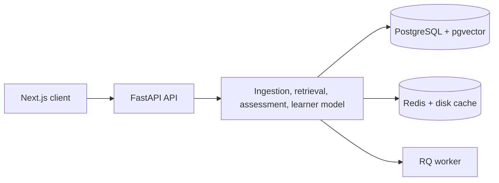
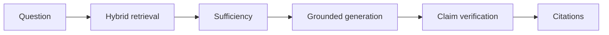
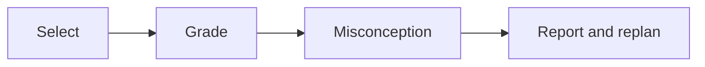

# KnowTrace Architecture Blueprint







Data flows from files to parsed chunks, provenance, embeddings, taxonomy,
retrieval, adaptive assessment, and planning. Docker Compose is the local
deployment; Vercel can host the frontend and a small VM can host API/worker.

## System Overview
KnowTrace is a Source-Anchored Adaptive AI Study Companion ingesting multimodal course materials (PDF textbooks, lecture slides, recorded video lectures) with complete provenance tracking, strictly grounded tutoring, cognitive misconception diagnosis, Bayesian knowledge tracing, and dual-vendor psychometric question validation.

```
                      +---------------------------------------+
                      |       Next.js 14 Web Frontend         |
                      |  (PDF viewer, Video sync, Study UI)   |
                      +-------------------+-------------------+
                                          |
                                    REST / WebSocket
                                          |
                      +-------------------v-------------------+
                      |      FastAPI Backend Gateway          |
                      |  (Request ID tracing, CORS, Auth)     |
                      +---------+-------------------+---------+
                                |                   |
               +----------------v-----+       +-----v----------------+
               |  Hybrid Search Core  |       |   Task Queue (RQ)    |
               | (Dense BGE-M3 + BM25)|       | (Whisper, PDF parser)|
               +----------------+-----+       +-----+----------------+
                                |                   |
    +---------------------------v-------------------v-------------------------+
    |                     PostgreSQL 16 + pgvector                            |
    |  - 15 Relational Tables with Provenance Spine                           |
    |  - HNSW Dense Vector Indexing (1024-dim) & TSVECTOR Lexical Indexes     |
    +-------------------------------------------------------------------------+
```

## Non-Negotiable Core Rules
1. **Provenance Spine**: Every content chunk stores `source_id` + `page` | `slide` | `ts_start`/`ts_end` (+ `bbox` for figures/tables).
2. **LLM Central Gateway**: All LLM calls pass through `backend/core/llm.py` via `call_llm(vendor, prompt, json_schema, images, temperature)` with exponential backoff retries.
3. **Dual-Vendor Architecture**:
   - **Vendor A (Generation & Vision)**: Google Gemini (`gemini-1.5-pro`)
   - **Vendor B (Validation & Verification)**: Groq / Claude (`llama3-70b` / `claude-3-5-sonnet`)
4. **Prompt Centralization**: Prompts are strictly banned from inline code and must live in `services/<module>/prompts.py`.
5. **Grounded Tutoring & Refusal**: Unsupported questions are refused with `"Not found in your course material"`. Outside knowledge must be labeled `[OUTSIDE KNOWLEDGE]`.
6. **Psychometric Question Pipeline**: Only questions validated and marked `status="approved"` by Vendor B can be served to learners.
7. **Unified Course Discovery & Connector Architecture**:
   - Multi-platform modular connectors (`backend/connectors/base.py` & registry) support **NPTEL, SWAYAM, MIT OCW, MITx, Khan Academy, edX, and Coursera**.
   - Clear attribution with `source_platform`, `source_url`, and explicit `access_type` (`free`, `free_paid_cert`, `audit_limited`).
   - Two-stage architecture:
     - **Discovery Stage**: Lightweight federated search over catalog metadata (`CatalogCourse`, `CourseModule`, `CourseResource`).
     - **Ingestion Stage**: One-click promotion to active `Course` for AI tutoring, DAG knowledge mapping, Bayesian Knowledge Tracing, and adaptive quizzes.

